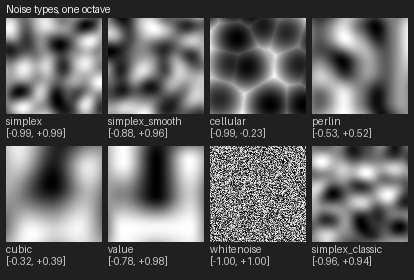
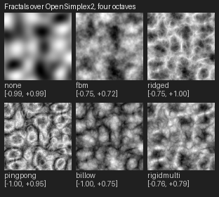
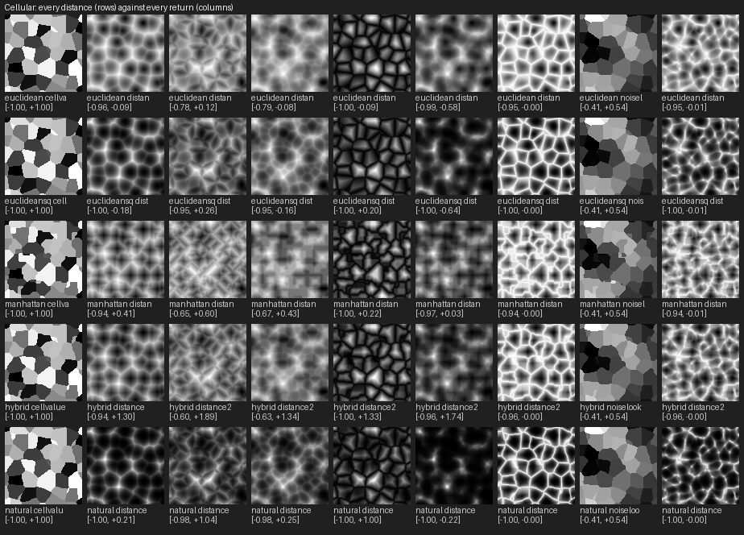
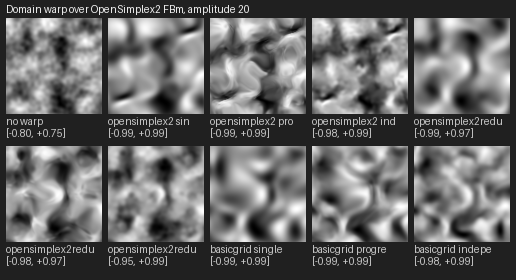
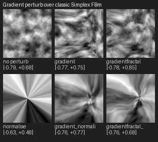
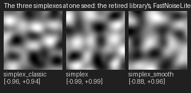
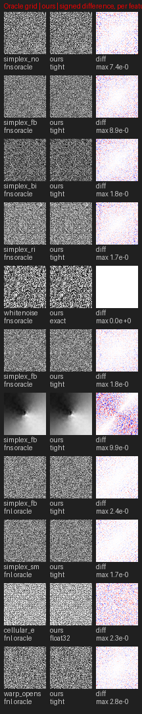

# Noise gallery

**Status:** Living. Generated by `tools/noise_gallery.py` from the kernel record's enums; regenerate after
porting a noise (`python tools/noise_gallery.py`), and `tests/test_noise_gallery.py` fails when this page
falls behind them. Do not edit by hand.

Every tile is a 96 x 96 heightfield over x and z at y = 0, seed 12345, through `sample_grid`, mapped to grey
over the tile's own range (in the caption). The names are the caller-facing ones from
`hog_noise.families` (the enum names); what each is and
where it came from is in [PYTHON_UPGRADE_AND_FASTNOISE.md](../PYTHON_UPGRADE_AND_FASTNOISE.md), section 4.2.

## Noise types, one octave

| # | Tile | Record |
| --- | --- | --- |
| 0 | `simplex` | `frequency=0.03` |
| 1 | `simplex_smooth` | `frequency=0.03, noise_type=open_simplex2s` |
| 2 | `cellular` | `frequency=0.03, noise_type=cellular` |
| 3 | `perlin` | `frequency=0.03, noise_type=perlin` |
| 4 | `cubic` | `frequency=0.03, noise_type=value_cubic` |
| 5 | `value` | `frequency=0.03, noise_type=value` |
| 6 | `whitenoise` | `frequency=0.03, noise_type=white_noise` |
| 7 | `simplex_classic` | `frequency=0.03, noise_type=simplex_classic` |

## Fractals over OpenSimplex2, four octaves

| # | Tile | Record |
| --- | --- | --- |
| 0 | `none` | `frequency=0.03, octaves=4` |
| 1 | `fbm` | `frequency=0.03, fractal_type=fbm, octaves=4` |
| 2 | `ridged` | `frequency=0.03, fractal_type=ridged, octaves=4` |
| 3 | `pingpong` | `frequency=0.03, fractal_type=ping_pong, octaves=4` |
| 4 | `billow` | `frequency=0.03, fractal_type=billow, octaves=4` |
| 5 | `rigidmulti` | `frequency=0.03, fractal_type=rigid_multi, octaves=4` |

## Cellular: every distance (rows) against every return (columns)

| # | Tile | Record |
| --- | --- | --- |
| 0 | `euclidean cellvalue` | `frequency=0.06, noise_type=cellular, cellular_distance=euclidean, cellular_return=cell_value, cellular_lookup_type=perlin, cellular_lookup_frequency=0.3` |
| 1 | `euclidean distance` | `frequency=0.06, noise_type=cellular, cellular_distance=euclidean, cellular_lookup_type=perlin, cellular_lookup_frequency=0.3` |
| 2 | `euclidean distance2` | `frequency=0.06, noise_type=cellular, cellular_distance=euclidean, cellular_return=distance2, cellular_lookup_type=perlin, cellular_lookup_frequency=0.3` |
| 3 | `euclidean distance2add` | `frequency=0.06, noise_type=cellular, cellular_distance=euclidean, cellular_return=distance2_add, cellular_lookup_type=perlin, cellular_lookup_frequency=0.3` |
| 4 | `euclidean distance2sub` | `frequency=0.06, noise_type=cellular, cellular_distance=euclidean, cellular_return=distance2_sub, cellular_lookup_type=perlin, cellular_lookup_frequency=0.3` |
| 5 | `euclidean distance2mul` | `frequency=0.06, noise_type=cellular, cellular_distance=euclidean, cellular_return=distance2_mul, cellular_lookup_type=perlin, cellular_lookup_frequency=0.3` |
| 6 | `euclidean distance2div` | `frequency=0.06, noise_type=cellular, cellular_distance=euclidean, cellular_return=distance2_div, cellular_lookup_type=perlin, cellular_lookup_frequency=0.3` |
| 7 | `euclidean noiselookup` | `frequency=0.06, noise_type=cellular, cellular_distance=euclidean, cellular_return=noise_lookup, cellular_lookup_type=perlin, cellular_lookup_frequency=0.3` |
| 8 | `euclidean distance2cave` | `frequency=0.06, noise_type=cellular, cellular_distance=euclidean, cellular_return=distance2_cave, cellular_lookup_type=perlin, cellular_lookup_frequency=0.3` |
| 9 | `euclideansq cellvalue` | `frequency=0.06, noise_type=cellular, cellular_return=cell_value, cellular_lookup_type=perlin, cellular_lookup_frequency=0.3` |
| 10 | `euclideansq distance` | `frequency=0.06, noise_type=cellular, cellular_lookup_type=perlin, cellular_lookup_frequency=0.3` |
| 11 | `euclideansq distance2` | `frequency=0.06, noise_type=cellular, cellular_return=distance2, cellular_lookup_type=perlin, cellular_lookup_frequency=0.3` |
| 12 | `euclideansq distance2add` | `frequency=0.06, noise_type=cellular, cellular_return=distance2_add, cellular_lookup_type=perlin, cellular_lookup_frequency=0.3` |
| 13 | `euclideansq distance2sub` | `frequency=0.06, noise_type=cellular, cellular_return=distance2_sub, cellular_lookup_type=perlin, cellular_lookup_frequency=0.3` |
| 14 | `euclideansq distance2mul` | `frequency=0.06, noise_type=cellular, cellular_return=distance2_mul, cellular_lookup_type=perlin, cellular_lookup_frequency=0.3` |
| 15 | `euclideansq distance2div` | `frequency=0.06, noise_type=cellular, cellular_return=distance2_div, cellular_lookup_type=perlin, cellular_lookup_frequency=0.3` |
| 16 | `euclideansq noiselookup` | `frequency=0.06, noise_type=cellular, cellular_return=noise_lookup, cellular_lookup_type=perlin, cellular_lookup_frequency=0.3` |
| 17 | `euclideansq distance2cave` | `frequency=0.06, noise_type=cellular, cellular_return=distance2_cave, cellular_lookup_type=perlin, cellular_lookup_frequency=0.3` |
| 18 | `manhattan cellvalue` | `frequency=0.06, noise_type=cellular, cellular_distance=manhattan, cellular_return=cell_value, cellular_lookup_type=perlin, cellular_lookup_frequency=0.3` |
| 19 | `manhattan distance` | `frequency=0.06, noise_type=cellular, cellular_distance=manhattan, cellular_lookup_type=perlin, cellular_lookup_frequency=0.3` |
| 20 | `manhattan distance2` | `frequency=0.06, noise_type=cellular, cellular_distance=manhattan, cellular_return=distance2, cellular_lookup_type=perlin, cellular_lookup_frequency=0.3` |
| 21 | `manhattan distance2add` | `frequency=0.06, noise_type=cellular, cellular_distance=manhattan, cellular_return=distance2_add, cellular_lookup_type=perlin, cellular_lookup_frequency=0.3` |
| 22 | `manhattan distance2sub` | `frequency=0.06, noise_type=cellular, cellular_distance=manhattan, cellular_return=distance2_sub, cellular_lookup_type=perlin, cellular_lookup_frequency=0.3` |
| 23 | `manhattan distance2mul` | `frequency=0.06, noise_type=cellular, cellular_distance=manhattan, cellular_return=distance2_mul, cellular_lookup_type=perlin, cellular_lookup_frequency=0.3` |
| 24 | `manhattan distance2div` | `frequency=0.06, noise_type=cellular, cellular_distance=manhattan, cellular_return=distance2_div, cellular_lookup_type=perlin, cellular_lookup_frequency=0.3` |
| 25 | `manhattan noiselookup` | `frequency=0.06, noise_type=cellular, cellular_distance=manhattan, cellular_return=noise_lookup, cellular_lookup_type=perlin, cellular_lookup_frequency=0.3` |
| 26 | `manhattan distance2cave` | `frequency=0.06, noise_type=cellular, cellular_distance=manhattan, cellular_return=distance2_cave, cellular_lookup_type=perlin, cellular_lookup_frequency=0.3` |
| 27 | `hybrid cellvalue` | `frequency=0.06, noise_type=cellular, cellular_distance=hybrid, cellular_return=cell_value, cellular_lookup_type=perlin, cellular_lookup_frequency=0.3` |
| 28 | `hybrid distance` | `frequency=0.06, noise_type=cellular, cellular_distance=hybrid, cellular_lookup_type=perlin, cellular_lookup_frequency=0.3` |
| 29 | `hybrid distance2` | `frequency=0.06, noise_type=cellular, cellular_distance=hybrid, cellular_return=distance2, cellular_lookup_type=perlin, cellular_lookup_frequency=0.3` |
| 30 | `hybrid distance2add` | `frequency=0.06, noise_type=cellular, cellular_distance=hybrid, cellular_return=distance2_add, cellular_lookup_type=perlin, cellular_lookup_frequency=0.3` |
| 31 | `hybrid distance2sub` | `frequency=0.06, noise_type=cellular, cellular_distance=hybrid, cellular_return=distance2_sub, cellular_lookup_type=perlin, cellular_lookup_frequency=0.3` |
| 32 | `hybrid distance2mul` | `frequency=0.06, noise_type=cellular, cellular_distance=hybrid, cellular_return=distance2_mul, cellular_lookup_type=perlin, cellular_lookup_frequency=0.3` |
| 33 | `hybrid distance2div` | `frequency=0.06, noise_type=cellular, cellular_distance=hybrid, cellular_return=distance2_div, cellular_lookup_type=perlin, cellular_lookup_frequency=0.3` |
| 34 | `hybrid noiselookup` | `frequency=0.06, noise_type=cellular, cellular_distance=hybrid, cellular_return=noise_lookup, cellular_lookup_type=perlin, cellular_lookup_frequency=0.3` |
| 35 | `hybrid distance2cave` | `frequency=0.06, noise_type=cellular, cellular_distance=hybrid, cellular_return=distance2_cave, cellular_lookup_type=perlin, cellular_lookup_frequency=0.3` |
| 36 | `natural cellvalue` | `frequency=0.06, noise_type=cellular, cellular_distance=natural, cellular_return=cell_value, cellular_lookup_type=perlin, cellular_lookup_frequency=0.3` |
| 37 | `natural distance` | `frequency=0.06, noise_type=cellular, cellular_distance=natural, cellular_lookup_type=perlin, cellular_lookup_frequency=0.3` |
| 38 | `natural distance2` | `frequency=0.06, noise_type=cellular, cellular_distance=natural, cellular_return=distance2, cellular_lookup_type=perlin, cellular_lookup_frequency=0.3` |
| 39 | `natural distance2add` | `frequency=0.06, noise_type=cellular, cellular_distance=natural, cellular_return=distance2_add, cellular_lookup_type=perlin, cellular_lookup_frequency=0.3` |
| 40 | `natural distance2sub` | `frequency=0.06, noise_type=cellular, cellular_distance=natural, cellular_return=distance2_sub, cellular_lookup_type=perlin, cellular_lookup_frequency=0.3` |
| 41 | `natural distance2mul` | `frequency=0.06, noise_type=cellular, cellular_distance=natural, cellular_return=distance2_mul, cellular_lookup_type=perlin, cellular_lookup_frequency=0.3` |
| 42 | `natural distance2div` | `frequency=0.06, noise_type=cellular, cellular_distance=natural, cellular_return=distance2_div, cellular_lookup_type=perlin, cellular_lookup_frequency=0.3` |
| 43 | `natural noiselookup` | `frequency=0.06, noise_type=cellular, cellular_distance=natural, cellular_return=noise_lookup, cellular_lookup_type=perlin, cellular_lookup_frequency=0.3` |
| 44 | `natural distance2cave` | `frequency=0.06, noise_type=cellular, cellular_distance=natural, cellular_return=distance2_cave, cellular_lookup_type=perlin, cellular_lookup_frequency=0.3` |

## Domain warp over OpenSimplex2 FBm, amplitude 20

| # | Tile | Record |
| --- | --- | --- |
| 0 | `no warp` | `frequency=0.03, fractal_type=fbm` |
| 1 | `opensimplex2 single` | `frequency=0.03, domain_warp=open_simplex2, domain_warp_amp=20.0` |
| 2 | `opensimplex2 progressive` | `frequency=0.03, fractal_type=domain_warp_progressive, domain_warp=open_simplex2, domain_warp_amp=20.0` |
| 3 | `opensimplex2 independent` | `frequency=0.03, fractal_type=domain_warp_independent, domain_warp=open_simplex2, domain_warp_amp=20.0` |
| 4 | `opensimplex2reduced single` | `frequency=0.03, domain_warp=open_simplex2_reduced, domain_warp_amp=20.0` |
| 5 | `opensimplex2reduced progressive` | `frequency=0.03, fractal_type=domain_warp_progressive, domain_warp=open_simplex2_reduced, domain_warp_amp=20.0` |
| 6 | `opensimplex2reduced independent` | `frequency=0.03, fractal_type=domain_warp_independent, domain_warp=open_simplex2_reduced, domain_warp_amp=20.0` |
| 7 | `basicgrid single` | `frequency=0.03, domain_warp=basic_grid, domain_warp_amp=20.0` |
| 8 | `basicgrid progressive` | `frequency=0.03, fractal_type=domain_warp_progressive, domain_warp=basic_grid, domain_warp_amp=20.0` |
| 9 | `basicgrid independent` | `frequency=0.03, fractal_type=domain_warp_independent, domain_warp=basic_grid, domain_warp_amp=20.0` |

## Gradient perturb over classic Simplex FBm

| # | Tile | Record |
| --- | --- | --- |
| 0 | `no perturb` | `frequency=0.03, noise_type=simplex_classic, fractal_type=fbm, octaves=4` |
| 1 | `gradient` | `frequency=0.03, noise_type=simplex_classic, fractal_type=fbm, octaves=4, perturb=gradient, perturb_normalise_length=30.0` |
| 2 | `gradientfractal` | `frequency=0.03, noise_type=simplex_classic, fractal_type=fbm, octaves=4, perturb=gradient_fractal, perturb_normalise_length=30.0` |
| 3 | `normalise` | `frequency=0.03, noise_type=simplex_classic, fractal_type=fbm, octaves=4, perturb=normalise, perturb_normalise_length=30.0` |
| 4 | `gradient_normalise` | `frequency=0.03, noise_type=simplex_classic, fractal_type=fbm, octaves=4, perturb=gradient_normalise, perturb_normalise_length=30.0` |
| 5 | `gradientfractal_normalise` | `frequency=0.03, noise_type=simplex_classic, fractal_type=fbm, octaves=4, perturb=gradient_fractal_normalise, perturb_normalise_length=30.0` |

## The three simplexes at one seed: the retired library's, FastNoiseLite's, and the smooth variant

| # | Tile | Record |
| --- | --- | --- |
| 0 | `simplex_classic` | `frequency=0.03, noise_type=simplex_classic` |
| 1 | `simplex` | `frequency=0.03` |
| 2 | `simplex_smooth` | `frequency=0.03, noise_type=open_simplex2s` |

## Comparisons against the oracles, a representative set

A representative set of the features the oracles check by point, one or two per family (the tests compare
every ported feature and every perturb mode; portability.md has them all): the oracle's 128 x 128 grid,
ours, and the signed difference.
`fns` is the retired FastNoiseSIMD (its own hash, so only its own features compare by point); `fnl` is
`pyfastnoiselite`, and the warp row comes from the C++ harness in `tools/noise_oracle`. Every other
comparison the tests make is in [portability.md](../../tests/vectors/noise/portability.md); a mismatch past
the advisory bar writes a sheet to `tests/vectors/noise/reports/` and waits for a verdict in `accepted.json`.

Read the difference tile, not the grids: the captured grids span 4096 units at frequency 0.01, about three
samples per period, so at 128 px they alias into static for every feature but the smoothest. The
difference is scaled to its own maximum (white is zero) and the caption carries the measured maximum.

| Feature | Class | Max abs | Mean abs | Correlation |
| --- | --- | --- | --- | --- |
| `fns/simplex_none` | tight | 7.42e-06 | 6.44e-07 | 1.000000 |
| `fns/simplex_fbm` | tight | 8.91e-06 | 8.10e-07 | 1.000000 |
| `fns/simplex_billow` | tight | 1.78e-05 | 1.62e-06 | 1.000000 |
| `fns/simplex_rigidmulti` | tight | 1.70e-05 | 1.52e-06 | 1.000000 |
| `fns/whitenoise_none` | exact | 0.00e+00 | 0.00e+00 | 1.000000 |
| `fns/simplex_fbm_perturb_gradient` | tight | 1.76e-05 | 1.05e-06 | 1.000000 |
| `fns/simplex_fbm_perturb_gradientfractal_normalise` | tight | 9.90e-06 | 1.93e-06 | 1.000000 |
| `fnl/simplex_fbm` | tight | 2.43e-05 | 1.03e-06 | 1.000000 |
| `fnl/simplex_smooth_fbm` | tight | 1.74e-05 | 8.15e-07 | 1.000000 |
| `fnl/cellular_euclidean_distance2div` | float32 | 2.27e-07 | 3.34e-08 | 1.000000 |
| `fnl/warp_opensimplex2_domain_warp_progressive` | tight | 2.85e-05 | 1.85e-06 | 1.000000 |
