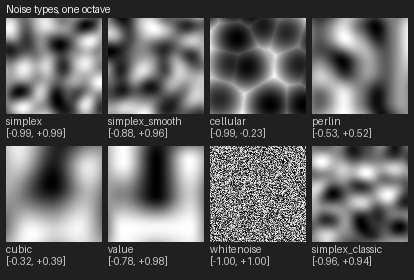
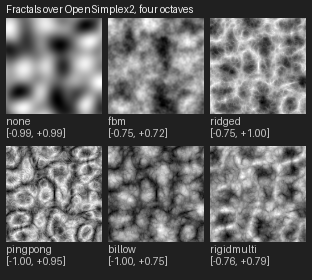
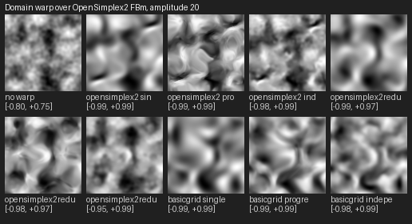

# HogNoise

Procedural noise for Python. Every FastNoiseLite and FastNoiseSIMD algorithm in one package, fast with numba, exact with
numpy, and checked against the original libraries.

<p>
  
  
  
</p>

## Install

```bash
pip install "hog-noise[jit] @ git+https://github.com/HogJonny-AMZN/HogNoise"
```

Python 3.11 to 3.13. The only dependency is numpy (1.26 or newer); `jit` adds numba for speed. Not on PyPI yet.

## Use it

```python
from hog_noise import FractalType, NoiseParams, NoiseType, make_sampler

params = NoiseParams(
    seed=1337, frequency=0.02, noise_type=NoiseType.OPEN_SIMPLEX2, fractal_type=FractalType.FBM, octaves=4
)
sampler, _ = make_sampler(params)

height = sampler.sample_grid((0, 0, 0), (256, 1, 256))[:, 0, :]  # a 256 x 256 heightfield, float32
value = sampler.sample(10.0, 20.0, 0.0)  # one point
```

`make_sampler` picks the fastest implementation installed: numba, then the original FastNoiseLite binding if you have it,
then plain numpy. numba and numpy give the same numbers bit for bit; the binding agrees to float32 rounding. Batches of
scattered points go through `sampler.sample_points(xs, ys, zs, out)`.

## What's in it

- **Noise:** OpenSimplex2, OpenSimplex2S, classic Simplex (FastNoiseSIMD's, so old seeds reproduce), Perlin, Value,
  ValueCubic, Cellular, white noise.
- **Fractals:** FBm, Ridged, PingPong, Billow, RigidMulti, with weighted strength.
- **Cellular:** five distance functions, nine return types (including NoiseLookup and Distance2Cave), jitter.
- **Domain warp:** three warp types, progressive and independent; FastNoiseSIMD's five gradient-perturb modes.
- **Grids:** `sample_grid` with axis scales; a 1024 x 1024 field takes about 17 ms with numba.

Every one of them is shown in the [gallery](Docs/noise/GALLERY.md).

## Why it exists

I use noise in my own projects, LargeWorlds and SpriteJammer, and I wanted all of it, with no restraints. The Python
wrapper I had been using was last released in 2021 and stuck on Python 3.9, which blocked everything else I wanted to move
to, and it had been quietly handing me simplex noise when I asked for cellular. I could build the whole thing; it was only
a matter of time, and I didn't want to wait.

So I ported it, with AI, in days to weeks rather than the weeks to months it would have taken me alone. I'm not a noise
researcher. That is why nothing here asks for trust: every feature is compared against output captured from the original
libraries.

## How it's checked

- 208 comparisons against the originals: 75 bit-identical, the rest within float32 rounding (largest difference 2.0e-4).
  They are listed in [the comparison table](tests/vectors/noise/portability.md).
- A difference never quietly passes or fails: it produces a side-by-side image and waits for a person's verdict.
- The suite runs on Python 3.11 with numpy 1.26, on 3.13, and with numpy alone.

## Limits

- 2D and 3D only: no 4D, no derivatives, no tileable noise yet. No GPU path yet.
- Close to, not byte-identical with, the originals: the maths is float64 after the frequency multiply.
- If you need 4D, a node editor or raw C++ speed, [FastNoise2](https://github.com/Auburn/FastNoise2) is the one to use.

What comes next is on the [board](Docs/plan/board/); a conformance harness that other ports can run is first.

## Contributing

[AGENTS.md](AGENTS.md) is the entry point, for people and AI agents alike; [llms.txt](llms.txt) is the short index.
[PROVENANCE.md](PROVENANCE.md) says where the code came from.

## Licence

MIT, see [LICENSE](LICENSE). It is a port, so [NOTICE](NOTICE) carries the FastNoiseLite and FastNoiseSIMD licences.
