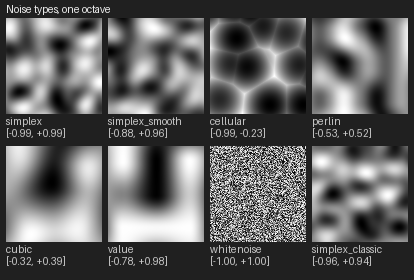
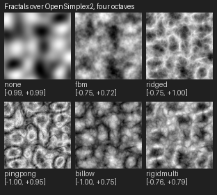
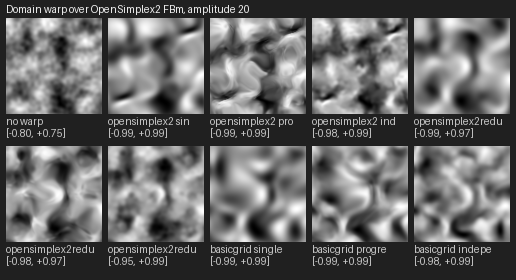

# HogNoise

Procedural noise for Python: Perlin, OpenSimplex2, cellular (Worley), value and white noise, with fractals and domain warp. Every FastNoiseLite and FastNoiseSIMD algorithm in one package, fast with numba, exact with numpy, and checked against the original libraries.

<p>
  
  
  
</p>

## Who it's for

If you searched for Perlin or simplex noise in Python, cellular or Voronoi noise over numpy, fractal Brownian motion, domain warping, or "FastNoiseLite, but Python", you are in the right place.

- **Terrain, worlds and levels.** Heightmaps, biome masks, caves, scatter: whole numpy grids at once, a 1024 x 1024 field in about 17 ms with numba (numpy alone gives the same numbers, slower).
- **Game developers who already know FastNoiseLite** from Godot 4, Unity or C++. Same algorithms, same parameters, same seeds, so a tool or a bake in Python agrees with the engine to float32 rounding.
- **Anyone stuck on `pyfastnoisesimd`.** FastNoiseSIMD's classic Simplex is here as `NoiseType.SIMPLEX_CLASSIC`, with its Billow, RigidMulti and gradient perturb, and its white noise too: seeds for those reproduce, within float32 rounding of the original, on Python 3.11 to 3.13. Its Perlin, value and cellular hash differently, so fields made with those will change.
- **Technical artists in a DCC host.** It installs with numpy alone, no compiler, into the host's own Python without touching its numpy (`--no-deps`). CI tests each supported host's Python and numpy: 3.11 with numpy 1.26 for Maya 2026, Houdini 21 and Unreal 5.8, and 3.13 with numpy 2.3 for Blender 5.2 ([the DCC hosts](Docs/standards/compatibility-matrix-project.md)).
- **Textures, generative art and synthetic data.** Seeded and repeatable: the same parameters give the same array, with or without numba.

What it adds over the other options is proof: the numbers are compared against the original C++ libraries, and the two renderings agree bit for bit. If you need 4D, a node editor or raw C++ speed today, see [Limits](#limits).

## Install

```bash
pip install "hog-noise[fast] @ git+https://github.com/HogJonny-AMZN/HogNoise#subdirectory=packages/python/hog-noise"
```

Python 3.11 to 3.13. The only dependency is numpy (1.26 or newer); `[fast]` adds numba. Leave it off and you get the same numbers, just slower. `[gpu]` adds [wgpu](https://github.com/pygfx/wgpu-py) for the GPU rung (below). Not on PyPI yet.

## Use it

```python
from hog_noise import FractalType, NoiseParams, NoiseType, make_sampler

params = NoiseParams(
    seed=1337, frequency=0.02, noise_type=NoiseType.OPEN_SIMPLEX2, fractal_type=FractalType.FBM, octaves=4
)
sampler, _ = make_sampler(params)

height = sampler.sample_grid((0, 0, 0), (256, 1, 256))[:, 0, :]  # a 256 x 256 heightfield, float32
value = sampler.sample(10.0, 20.0, 0.0)  # one point
```

`make_sampler` uses numba when it is installed and numpy when it is not. They give the same numbers bit for bit, so installing numba changes how fast you get your noise, never which noise you get. Batches of scattered points go through `sampler.sample_points(xs, ys, zs, out)`.

### On the GPU

Every noise above also runs as one WGSL compute shader on whatever GPU adapter [wgpu](https://github.com/pygfx/wgpu-py) finds. It has been run on Vulkan, Direct3D 12, OpenGL and Metal, hardware and software adapters both; Metal only on a hosted macOS runner's virtual GPU, not on Apple hardware directly. Install the `[gpu]` extra and ask for it by name; `make_sampler` never chooses it for you, so installing wgpu changes nothing until you do.

```python
sampler, _ = make_sampler(params, backend="wgpu")  # or set HOG_NOISE_BACKEND_NOISE=wgpu
height = sampler.sample_grid((0, 0, 0), (256, 1, 256))[:, 0, :]
```

The sampler has the same calls as the CPU ones. `HOG_NOISE_WGPU_ADAPTER` picks an adapter by part of its name (`"Microsoft Basic Render Driver"` is Windows' software adapter); one device is made per process and kept. To choose a back end instead, leave it unset and set wgpu's own `WGPU_BACKEND_TYPE` (`Vulkan`, `D3D12`, `OpenGL`, `Metal`). The two do not combine: a GPU offered on several back ends has one name, and with a name set the first back end listed wins. Without wgpu or an adapter, asking for the rung raises `BackendUnavailable` saying which. An `octaves` or `perturb_octaves` above 32 is refused on the GPU, since a loop that long can stall the device. A call with more points than the device binds in one buffer is refused before anything is uploaded, naming the most it can take. On an RTX 5090 and on WARP, the adapters measured, a buffer holds 2 GiB: 536,870,911 points a call, 268,435,455 for `warp_points_2d` and 178,956,970 for `warp_points`, which write two and three floats a point. Split a larger call; the rung does not split it for you.

What it claims: it is float32, so it is close to the CPU's numbers, not equal to them. Every feature is held to a bound per feature, measured on seven GPU adapters (an RTX 5090 on each of Vulkan, Direct3D 12 and OpenGL, two builds of Windows' WARP, Mesa's llvmpipe, and the macOS runner's Apple Paravirtual device on Metal) and written down in [a tolerance file](vectors/README.md#tolerance-files), over what the vectors sample: frequency 0.01 and coordinates up to 4,096 units. A smooth feature's rule has two parts: every point within a ceiling of 1e-2 per coordinate unit, and at least a stated fraction of points within a tight bound set from the vectors. The fraction is 0.9999 for most features and 0.9993 to 0.9996 for seven Perlin ones, because the GPU's float32 has rare spikes, a few in a million, that no sample's worst bounds. A cellular or white-noise feature, where float32 can flip a choice, holds most points to a tight bound, every point to the noise's range, and its shape by correlation. The fractions come from 65,536 fresh points per case on every adapter, not only the vectors' own. [The far-coordinate probe](Spikes/far_coordinates/README.md), drawing its own fresh points, passes every feature's rule inside the range on the 5090's Vulkan and Direct3D 12 and on WARP; it has not been run on Metal or llvmpipe. Nothing is claimed outside the vectors' range, and nothing about speed: it has not been benchmarked.

### The same shader in another host

For a host that does not run WGSL, the package also ships the shader as naga translates it: HLSL (Shader Model 5.0 and 6.0), GLSL 4.30 (one file per entry point) and SPIR-V, with the lookup tables as raw float32 and a manifest of every binding. `hog_noise.shaders` reads them with no `wgpu` and no GPU, only numpy, the package's one dependency:

```python
from hog_noise import shaders

hlsl = shaders.source("hlsl")
glsl = shaders.source("glsl", "sample_points_3d")
table = shaders.tables()  # what binding 1 holds
```

What is proven on every push: each file is what the pinned naga writes from the current WGSL, and each compiles or validates in its own language's tools (FXC and DXC, glslang, spirv-val). All three also run, in hosts written from the shaders' README alone, and pass every hog case within the wgpu rung's tolerance: the SPIR-V through wgpu on WARP, llvmpipe and Metal, the GLSL in OpenGL on llvmpipe, the HLSL on WARP through Direct3D 11 (FXC) and Direct3D 12 (DXC), and the SPIR-V in a Vulkan driver, Mesa's lavapipe, which consumes the shipped bytes where wgpu has naga read them back. Metal is not shipped. The bindings, the dispatch and how to fill the uniforms are in [the shaders' README](packages/python/hog-noise/src/hog_noise/shaders/README.md).

## What's in it

- **Noise:** OpenSimplex2, OpenSimplex2S, classic Simplex (FastNoiseSIMD's, so old seeds reproduce), Perlin, Value, ValueCubic, Cellular, white noise.
- **Fractals:** FBm, Ridged, PingPong, Billow, RigidMulti, with weighted strength.
- **Cellular:** five distance functions, nine return types (including NoiseLookup and Distance2Cave), jitter.
- **Domain warp:** three warp types, progressive and independent; FastNoiseSIMD's five gradient-perturb modes.
- **Grids:** `sample_grid` with axis scales; a 1024 x 1024 field takes about 17 ms with numba.

Every one of them is shown in the [gallery](Docs/noise/GALLERY.md).

## Why it exists

I use noise in my own projects, LargeWorlds and SpriteJammer, and I wanted all of it, with no restraints. The Python wrapper I had been using was last released in 2021 and stuck on Python 3.9, which blocked everything else I wanted to move to, and it had been quietly handing me simplex noise when I asked for cellular. I could build the whole thing; it was only a matter of time, and I didn't want to wait.

So I ported it, with AI, in days to weeks rather than the weeks to months it would have taken me alone. I'm not a noise researcher. That is why nothing here asks for trust: every feature is compared against output captured from the original libraries.

## How it's checked

- 208 comparisons against the originals: 75 bit-identical, the rest within float32 rounding (largest difference 2.0e-4). They are listed in [the comparison table](vectors/portability.md).
- A difference never quietly passes or fails: it produces a side-by-side image and waits for a person's verdict.
- The suite runs on Python 3.11 with numpy 1.26, on 3.13 with numpy 2.3 and with the latest, and with numpy alone; the GPU rung on three hosted runners' adapters in CI (WARP on Windows, llvmpipe on Ubuntu, the Apple Paravirtual device on Metal on macOS), each pinned to its back end, against every hog case and its [tolerance file](vectors/tolerance/wgpu.json), with the per-feature numbers in [the GPU table](vectors/portability-gpu.md).

## Limits

- 2D and 3D only: no 4D, no derivatives, no tileable noise yet.
- The GPU rung is float32 and measured only at frequency 0.01 out to 4,096 units; far from the origin it drifts further, and that is a later stage of the roadmap. It is not benchmarked. One call takes at most what the device binds in one buffer (2 GiB on the RTX 5090 and WARP), and a larger one is refused, not split. The HLSL, GLSL and SPIR-V files run against the vectors only on CI's software adapters, and the SPIR-V only through naga, not yet a Vulkan driver; there is no Metal file.
- Close to, not byte-identical with, the originals: the maths is float64 after the frequency multiply.
- For now, if you need 4D, a node editor or raw C++ speed, [FastNoise2](https://github.com/Auburn/FastNoise2) is the one to use.

Where it is going: [the north star](Docs/design/2026-11-01-north-star-roadmap.md). One package, every FastNoise2 node, 4D, and the same noise on the GPU in WGSL, HLSL, GLSL and Metal. The [board](Docs/plan/board/) tracks the steps; a conformance harness other ports can run is first.

## Contributing

[AGENTS.md](AGENTS.md) is the entry point, for people and AI agents alike; [llms.txt](llms.txt) is the short index. [PROVENANCE.md](PROVENANCE.md) says where the code came from.

## Licence

MIT, see [LICENSE](LICENSE). It is a port, so [NOTICE](NOTICE) carries the FastNoiseLite and FastNoiseSIMD licences.
